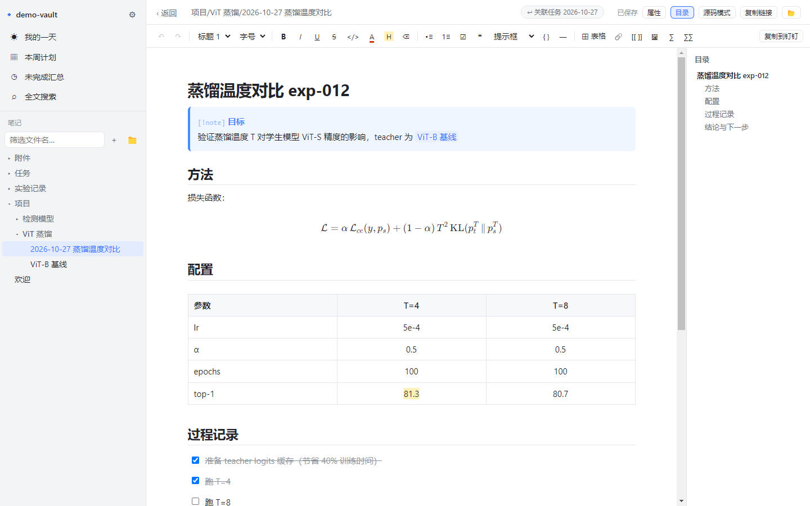
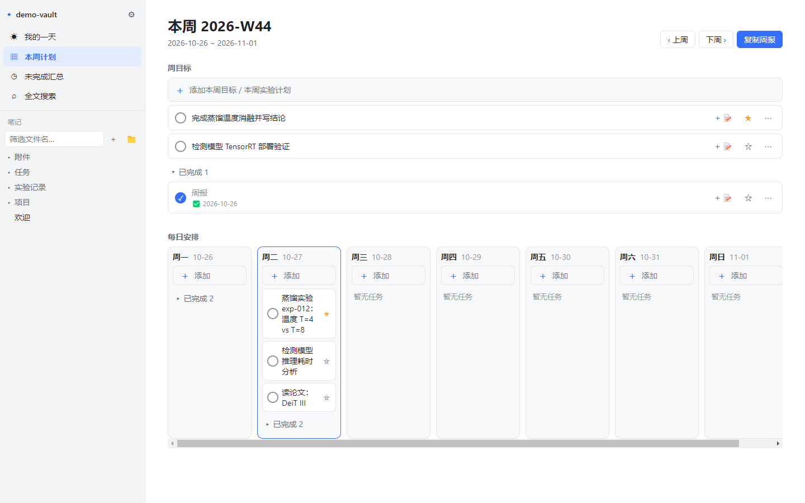
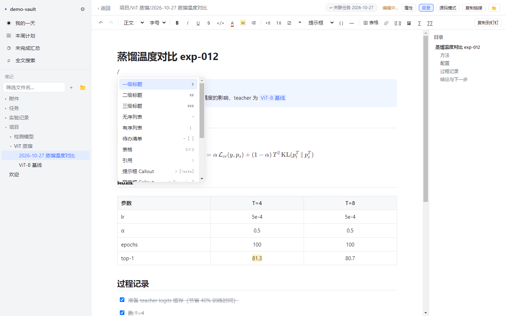
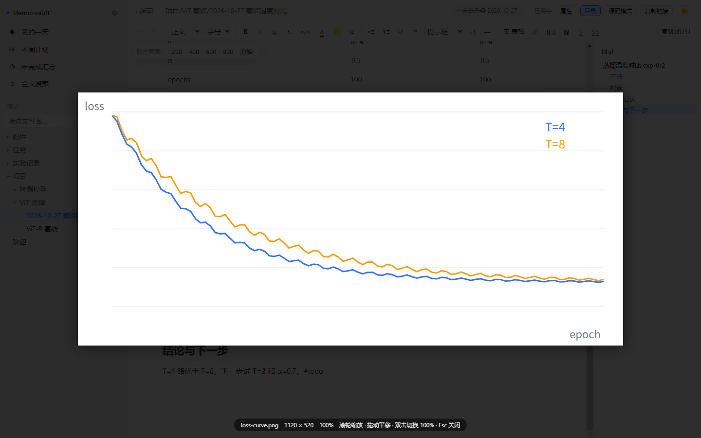

<!-- 长文：适合 CSDN / 掘金 / 知乎专栏 / 少数派。发布前把 <GitHub 地址> 替换成真实仓库链接，配图用 docs/images 下的截图 -->

# 我做了一个把「每日任务」和「工作记录」连起来的工具，数据全是 Markdown，兼容 Obsidian

> 一句话：To Do 式的日/周任务，每个任务一键生成一篇所见即所得的 Markdown 记录，图片表格能直接复制到钉钉。开源、本地、无账号。
>
> GitHub：<GitHub 地址>

## 起因

我是做算法的，平时的工作流是：

- **Microsoft To Do** 记今天要跑哪些实验、要修哪些 bug；
- **Obsidian** 记每个实验的配置、过程、结果和结论。

用了一年多，有三个问题一直很别扭：

1. **任务和记录是割裂的。** 周五写周报时，要先翻 To Do 看这周做了什么，再去 Obsidian 一篇篇找对应的记录。哪个实验被放弃了、为什么放弃，往往只存在于记忆里。
2. **Markdown 语法是负担。** 写个对比表格要手敲 `| --- |`，调颜色、插公式都要查语法。我想要的是钉钉文档那样点按钮就行，但存下来还是 Markdown。
3. **复制到钉钉图片就没了。** 笔记里的 loss 曲线、截图，复制到钉钉文档写汇报时全部丢失，只能一张张重新贴。

市面上的工具要么只解决其中一个，要么要我把数据迁到它的云上。于是自己写了一个：**KiteNote**。

## 它能做什么

### 1. 日 / 周任务，和 To Do 一样顺手

- 「我的一天」「本周计划」「未完成汇总」三个视图；
- 重要标记、子步骤、备注；「标记为不做」并写下原因（比如「数据集版本废弃，结论被 exp-011 覆盖」），以后翻得到；
- 自动带入昨天没做完的任务；
- 一键复制周报。

### 2. 任务一键生成工作记录，双向关联

任务上点「＋📝」，选一个模板生成笔记，内置「实验记录 / 问题排查 / 会议纪要 / 通用工作记录」，也可以在「模板」文件夹里写自己的模板。任务里自动写入 `[[双链]]`，笔记顶部也能跳回任务。周末回顾时，从任务清单就能直接点进每件事的记录。

我主要拿它记实验，但它同样适合开发排查日志、项目推进、会议纪要——任何「做了什么、怎么做的、结果如何」需要留痕的工作。

### 3. 所见即所得，不用记语法

钉钉风格的工具栏 + `/` 菜单：标题、字号、颜色、高亮、表格、提示框（Callout）、代码块、LaTeX 公式、双链。随时可以切回源码模式。

表格是我花时间最多的部分：鼠标悬停时，列上方、行左侧出现手柄，点一下就能插入、删除、对齐，拖动边线调宽度，单元格里也能放图片。

### 4. 图片：粘贴即保存，复制到钉钉不丢

- 截图直接 Ctrl+V，自动存成附件并写成 Obsidian 的 `![[...]]` 格式；
- 双击图片查看原图，支持滚轮缩放、拖动；
- 选中内容 Ctrl+C，或点「复制到钉钉」：图片会内嵌进剪贴板，**直接粘贴到钉钉文档 / 飞书 / Word 都能显示**。

### 5. 兼容 Obsidian，数据永远是你的

- 可以直接打开现有的 Obsidian 库原地使用，也可以整库导入（逐字节复制 + SHA1 校验）；
- `[[双链]]`、`![[嵌入]]`、Callout、`==高亮==`、公式、Obsidian Tasks 插件的 ⏫ / ✅ 都能正确读写；
- 移动或重命名笔记，全库的链接自动更新；
- 任务也是 Markdown：`任务/每日/2026-10-27.md` 里就是普通的 `- [ ] 任务`。

不想用了？什么都不用迁移，用 Obsidian 打开同一个文件夹就行。

### 6. 多设备同步：用你已有的网盘

库就是一个普通文件夹，放进百度网盘同步空间、坚果云、OneDrive、Syncthing 或 Git 都可以。手机上用 Obsidian App 打开同一个库查看。

## 技术上的几个坑

给感兴趣的同学：

- **Markdown 无损往返是最难的部分。** 编辑器是 TipTap（ProseMirror），解析用 markdown-it。为了让「打开 → 编辑 → 保存」不破坏 Obsidian 的写法，我给双链、嵌入、公式、高亮、Callout、软换行都写了自定义解析和序列化，并且用自己真实库里的 60 多篇笔记做往返测试。仍有少量等价写法会被规范化，编辑器会明确提示。
- **复制到钉钉：** 剪贴板 HTML 里图片改成 base64 内嵌；同时塞一段隐藏的原始 Markdown，所以从 KiteNote 复制再粘回 KiteNote 时，双链、公式、待办都能原样还原。
- **表格列宽：** Markdown 表格存不了列宽，调过宽度的表格会存成 HTML 表格，「恢复平均列宽」后变回 Markdown。

## 下载和反馈

- GitHub：<GitHub 地址>（MIT 开源）
- 目前提供 Windows 安装版和便携版；macOS / Linux 还没测试。
- 界面目前只有中文。

这是我自己每天在用的工具，问题和想法欢迎在 Issues 里提。如果它对你有用，点个 Star 是对我最大的鼓励。
